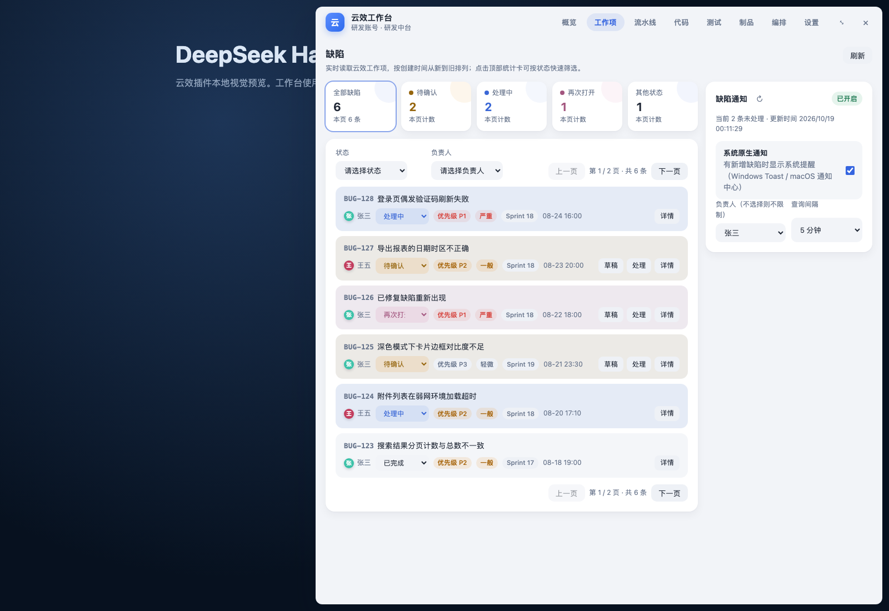
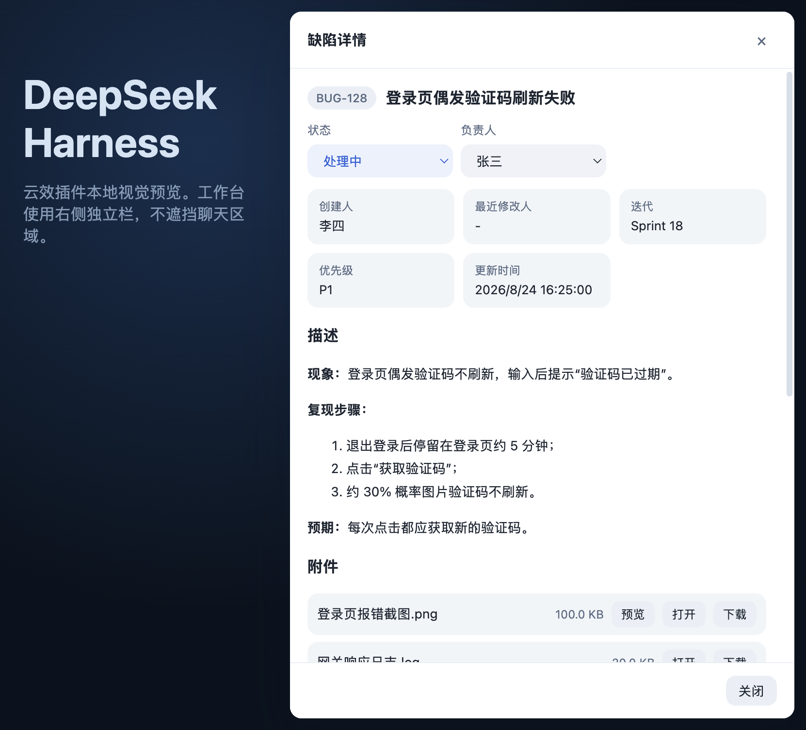
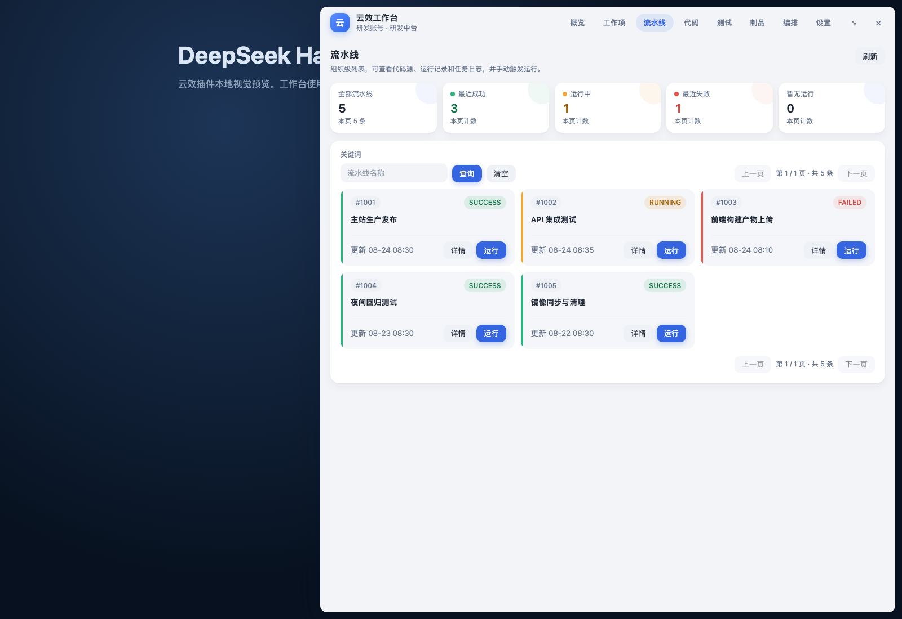
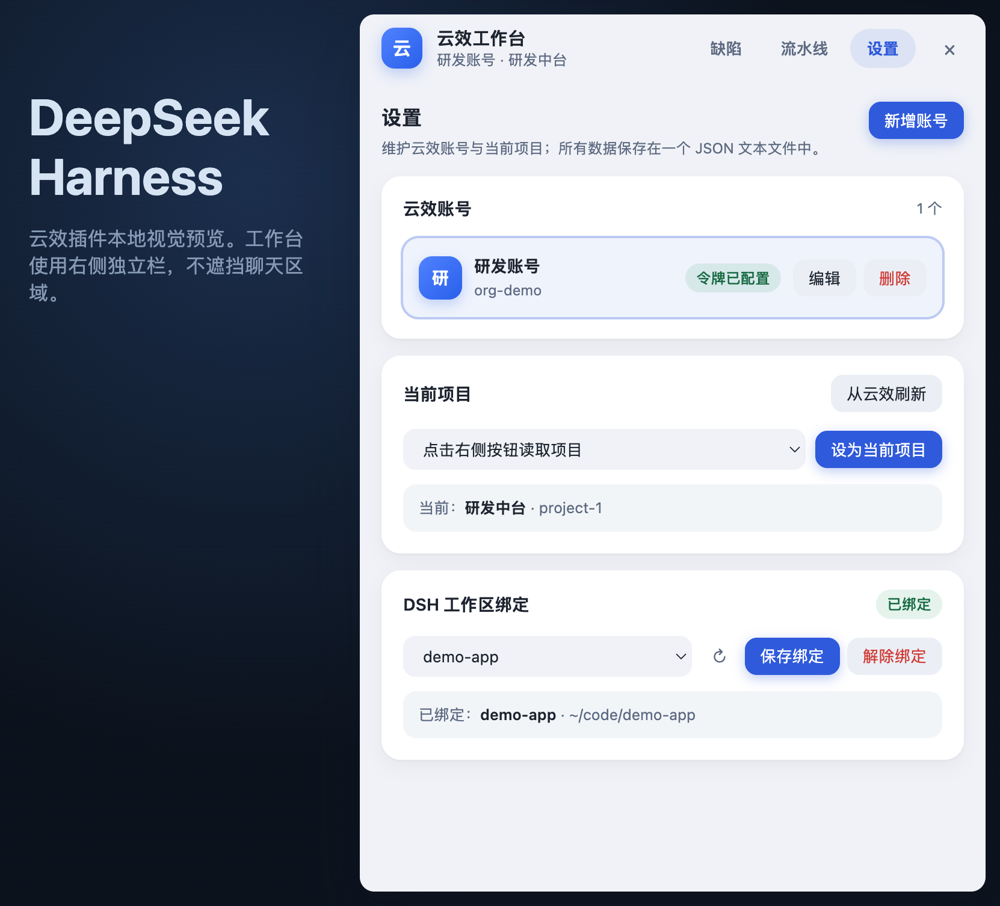

# dsh-yunxiao

适用于 [DeepSeek Harness](https://deepseek-harness.github.io/deepseek-harness/develop/basic/) 的轻量云效（阿里云 DevOps）工作台插件：管理云效账号与项目、处理缺陷、查看与运行流水线。配置与缓存保存在一个 JSON 文本文件中，无需数据库，也不接收消息回调或 Webhook。

语言 / Language: [中文](#中文) | [English](#english)

---

## 中文

### 界面预览

工作台集成在 Harness 侧栏，固定于右侧独立栏打开，不遮挡聊天区域，左边缘可拖拽调整宽度。以下截图均为本地预览构造的演示数据。



缺陷详情支持直接修改状态与负责人，查看描述、评论与附件，并以当前账号发布评论：



| 流水线 | 设置 |
| --- | --- |
|  |  |

### 功能

- **概览**：打开工作台的默认落点，顶部统计卡聚合待处理缺陷、流水线总数/运行中/最近失败、启用的编排与工作区绑定（点击直达对应页签）；待处理缺陷复用工作项页的方格卡片，可直接改状态或“草稿/处理”；编排以方格卡片展示，点击直接打开对应画布；
- **全页模式（默认）**：打开工作台即全页铺满——覆盖中间聊天区，只保留 Harness 左侧导航；头部 ⤢ 可切回右侧栏 480px 侧栏模式，切换会被记住；
- **工作项**：按创建时间分页展示缺陷，按状态/负责人筛选，顶部统计卡点击即按状态筛选；行内展示负责人徽章与优先级/严重度/迭代标签；列表与详情中可直接修改状态与负责人；“待确认”“再次打开”等状态的缺陷卡片使用柔和差异色；宽容器下缺陷通知配置与列表并排；支持发布评论、查看/下载附件，描述与附件中的图片支持全屏预览、复制与下载（桌面端经宿主写入系统剪贴板，无跨域限制）；
- **一键处理**：“待确认”“再次打开”的缺陷可一键“草稿/处理”到项目绑定的 DSH 工作区：草稿填入会话输入框不发送，处理直接创建会话发送，并自动带入缺陷标题与图片附件；
- **缺陷通知**：按项目开启系统原生通知（Windows Toast / macOS 通知中心），可指定负责人与轮询间隔；侧栏角标与未处理数一致，处理后自动清零；
- **流水线**：组织级列表、详情、代码源与分支、运行记录、阶段/任务与日志查看，顶部运行状态统计卡与回车搜索，卡片按最近运行状态着色多列展示；列表内点击“运行”直接弹出运行对话框选择 Codeup 分支（分支读取失败时仍可用默认配置运行或手动填写分支）；
- **代码（Codeup）**：组织内仓库列表，与流水线页同款的统计条、关键词搜索、卡片网格与分页；按仓库查看分支（保护分支/默认分支）与进行中的合并请求，检测无阻塞的 MR 可直接合入（需合并请求写入权限）；
- **测试**：组织内测试计划与用例通过率，统计条、卡片网格与分页；当前组织的测试管理 OpenAPI 未开放时给出明确提示，不影响其余功能；
- **制品**：组织内制品仓库列表，统计条、卡片网格与分页；同样在接口不可用时优雅降级；
- **流程编排（规则驱动）**：输入处理规则，宿主引擎自动拉取命中缺陷并分级处理——「样式/缺字段」全自动修复提交（切分支改代码 → 验证 → 创建 MR）、「C 端后台逻辑」先只读诊断待确认（批准后同一会话继续实施）、「其余」仅通知；触发范围（状态/负责人/轮询间隔/存量）与匹配条件（包含/排除关键词、优先级上限、类型）自由组合，内置两条规则模板与「试运行匹配」预览；去重台账 + 30 分钟冷却防重复处理，提交护栏（改动文件数、禁改路径、验证命令）拦住越界改动转人工，MR 一律人工合入；运行台账持久化（步骤时间线/日志/结构化结果/MR 链接/会话入口），结果评论与状态流转自动回写缺陷；浏览器关闭不影响执行；旧画布降级为只读展示；
- **设置**：顶部统计卡一览账号/令牌/项目/工作区/通知的配置状态；维护多个云效组织与个人访问令牌，账号以方格卡片展示并可一键切换当前账号；切换当前项目、为项目绑定 DSH 工作区（宽容器下两者左右并排）；
- **模型工具**：`yunxiao_list_defects`、`yunxiao_list_pipelines` 两个只读工具，默认读取工作台的当前账号与项目；
- **离线回退**：项目、缺陷与流水线列表写入文本缓存，OpenAPI 暂时失败时展示缓存并标记时间。

### 安装

在仓库根目录执行：

```powershell
dsh plugin --profile web add -w .

# 校验组合配置中出现 dsh-yunxiao
dsh --profile web --dump-config
```

安装或重新安装后，重启正在运行的 Harness Web/Desktop 实例即可在左侧栏底部看到“云效工作台”入口。

### 文档

完整的功能清单、数据存储与令牌安全说明、云效令牌权限、配置覆盖与开发验证步骤见 [d_yunxiao/README.md](./docs/README.md)。

---

## English

A lightweight Yunxiao (Alibaba Cloud DevOps) workbench plugin for [DeepSeek Harness](https://deepseek-harness.github.io/deepseek-harness/develop/basic/): manage Yunxiao accounts and projects, handle defects, and inspect/run pipelines. Configuration and cache live in a single JSON text file — no database, no message callbacks or webhooks.

### Screenshots

The workbench is integrated into the Harness sidebar and opens in a dedicated right-hand column, keeping the chat area unobstructed; drag its left edge to resize. All screenshots use fictional demo data built by the local preview harness.


The defect detail view lets you change status and assignee inline, read the description, comments and attachments, and post comments as the current account:


| Pipelines | Settings |
| --- | --- |
|  |  |

### Features

- **Overview**: the default landing page; stat cards aggregate pending defects, pipeline totals / running / recently failed, enabled flows and the workspace binding (click to jump to the tab); pending defects reuse the defect page's card grid with inline status changes and “Draft / Handle”; flows are shown as cards that open the corresponding canvas directly;
- **Defects**: paginated by creation time with status/assignee filters plus clickable status stat cards; rows show an assignee badge and priority/severity/sprint chips; change status and assignee inline from the list or detail view; soft accent colors highlight pending/reopened cards; the notification panel sits beside the list on wide containers; post comments, view and download attachments; images in descriptions/attachments support fullscreen preview, copy and download (the desktop app writes to the system clipboard via the host, with no cross-origin restrictions);
- **One-click handoff**: defects in “Pending confirmation / Reopened” status can be handed off to the project's bound DSH workspace as a “Draft” (fills the session input without sending) or “Handle” (creates and sends a new session), carrying the defect title and image attachments;
- **Defect notifications**: per-project native system notifications (Windows Toast / macOS Notification Center) with an optional assignee filter and polling interval; the sidebar badge mirrors the unhandled count and clears after handling;
- **Pipelines**: organization-level list, details, code sources and branches, run history, stage/job logs; run-status stat cards, Enter-to-search, status-tinted cards in an adaptive multi-column grid; the "Run" button in the list opens the run dialog directly for Codeup branch selection (if branches fail to load you can still run with pipeline defaults or type a branch manually);
- **Code (Codeup)**: organization repository list with the same stat cards, keyword search, card grid and pagination as the pipeline page; inspect branches (protected/default) and open merge requests per repository; MRs without blocking issues can be merged inline (requires merge-write permission);
- **Tests**: organization test plans with case pass rates, plus stat cards, card grid and pagination; a clear notice appears when the test-management OpenAPI is unavailable, without affecting other features;
- **Packages**: organization artifact repository list with stat cards, card grid and pagination; degrades gracefully when the API is unavailable;
- **Flows (rule-driven defect automation)**: enter handling rules and a resident host engine pulls matching defects automatically with graduated autonomy — styling/missing-field defects are fixed end to end (branch → code → verify → MR), C-end backend-logic defects get a read-only diagnosis that waits for your approval (approval resumes the same session to implement the fix), everything else only notifies; triggers (statuses/assignee/poll interval/backfill) and match conditions (include/exclude keywords, priority ceiling, workitem type) combine freely, with two built-in rule templates and a dry-run match preview; a persisted dedup ledger plus a 30-minute cooldown prevents repeat handling, submit guardrails (changed-file limit, forbidden paths, verify commands) hold out-of-scope changes for a human, and MRs are always merged manually; the run ledger persists step timelines, logs, structured results, MR links and session entries, and results write back to the defect as comments and status transitions; execution survives browser closes; the legacy canvas degrades to a read-only view;
- **Settings**: stat cards summarize account / token / project / workspace / notification status; manage multiple Yunxiao organizations and personal access tokens with accounts shown as cards (one click to switch the current account); switch the current project and bind a DSH workspace per project, side by side on wide containers;
- **Model tools**: two read-only tools, `yunxiao_list_defects` and `yunxiao_list_pipelines`, defaulting to the workbench's current account and project;
- **Offline fallback**: projects, defects and pipeline lists are cached to text files and shown (with a timestamp) when the OpenAPI is temporarily unavailable.

### Installation

Run from the repository root:

```powershell
dsh plugin --profile web add -w .

# Verify dsh-yunxiao appears in the composed config
dsh --profile web --dump-config
```

After installing (or reinstalling), restart the running Harness Web/Desktop instance; the “云效工作台” (Yunxiao Workbench) entry appears at the bottom of the left sidebar.

### Documentation

For the full feature list, data storage and token security notes, Yunxiao token permissions, config overrides and development verification, see [d_yunxiao/README.md](./docs/README.md).
